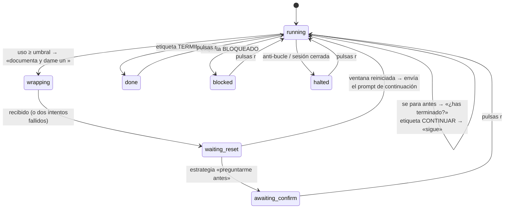

# Cómo funciona Relevo

[English](how-it-works.md) · **Español**

Este documento explica qué pasa por dentro: cómo pasa una conversación entre VS Code, Claude Desktop y la CLI, por qué Relevo tiene que «adoptarla», cómo decide qué hacer y de dónde saca cada dato.

## Una conversación es un archivo, no un programa

Cada conversación de Claude Code vive en un archivo JSON Lines:

```
~/.claude/projects/<carpeta del proyecto>/<id-de-sesión>.jsonl
```

Contiene cada mensaje, cada llamada a herramienta y su resultado, el modelo usado, el modo de permisos, etc.

La extensión de VS Code, Claude Desktop y la terminal son interfaces distintas del **mismo programa agente, `claude`**. La extensión de VS Code lleva su propia copia del binario. Uses la que uses, hay un proceso `claude` que:

1. carga el archivo de historial,
2. envía la conversación a los servidores de Anthropic, donde se ejecuta el modelo,
3. ejecuta las herramientas (editar archivos, lanzar comandos…) en tu Mac,
4. añade cada paso nuevo al archivo de historial.

Es decir, el modelo se ejecuta en la nube, pero el agente (el bucle que ejecuta las herramientas y lleva el historial) se ejecuta en tu máquina, mientras algún proceso tenga la conversación abierta.

## Qué pasa al cerrar la conversación en VS Code

La extensión termina su proceso `claude` y **el agente se para**. No sigue ejecutándose en ningún otro sitio. Todo lo que ya había terminado está en el historial. Si estaba a mitad de un turno, ese paso se corta, y los subagentes que hubiera lanzado se paran con él.

## Qué hace Relevo después

Relevo arranca un proceso nuevo con la CLI:

```sh
claude --resume <id-de-sesión> --remote-control --model <mismo modelo> --effort <mismo esfuerzo> --permission-mode <mismo modo>
```

dentro de una sesión de tmux llamada `relevo-<primeros 8 caracteres del id>`. Ese proceso lee el mismo archivo de historial y continúa desde el último punto guardado.

No es el mismo proceso pasando de un programa a otro. Es un **relevo**: un proceso se para y otro recoge el historial. Por eso Relevo te pide que cierres la conversación primero. Si dos procesos la tuvieran abierta, los dos escribirían en el mismo historial y la conversación se partiría en dos ramas.

### Dónde se ejecuta mientras la tiene Relevo

En ese proceso `claude` dentro de tmux, en tu Mac. tmux es una terminal que vive sin ventana, así que el proceso sigue aunque cierres Relevo o la terminal desde la que lo lanzaste. Relevo envía los mensajes pegando el texto en esa terminal y pulsando Intro, igual que harías tú.

### Dónde encaja Remote Control

claude.ai y la app del móvil no ejecutan nada. Son una **pantalla y un teclado remotos** del proceso que tenga la conversación abierta. Relevo arranca la CLI con `--remote-control`, y como el enlace va asociado a la conversación, el mismo enlace se conecta al proceso nuevo. Si ningún proceso tiene la conversación abierta, la web muestra el historial pero nadie contesta.

### Volver a VS Code

Es el mismo relevo al revés. Pulsa `x` en Relevo (o ejecuta `tmux kill-session -t relevo-<id>`) para terminar el proceso de tmux. Después abre la conversación desde el historial de VS Code o Desktop, o con `claude --resume <id>`. El proceso nuevo carga el historial completo, incluido todo lo que pasó mientras la tenía Relevo.

<a id="por-que-adoptar"></a>
## Por qué Relevo tiene que adoptar la conversación

Relevo necesita escribir mensajes en la conversación como si fueras tú. Se probaron y descartaron estas opciones:

| Opción | Por qué no |
|---|---|
| `claude -p --resume <id> "mensaje"` | Funciona con una conversación cerrada, pero si sigue abierta en VS Code, el proceso nuevo escribe una **rama paralela** en el historial. La sesión viva nunca ve el mensaje. |
| El socket local de mensajería entre sesiones (`/tmp/cc-socks/<pid>.sock`) | Es un protocolo interno. La sesión que lo recibe lo trata como un mensaje de *otra sesión*, no del usuario, y puede retenerlo según su configuración. |
| La API web de Remote Control | No está documentada y requiere usar directamente tu token OAuth. |
| **Ejecutar la conversación en una terminal que controla Relevo** | Solo usa opciones documentadas de la CLI. Los mensajes llegan como turnos reales del usuario, Remote Control sigue funcionando y los avisos de permisos te siguen llegando. ✔ |

## El bucle de decisión

Cada 10 segundos Relevo mira la conversación, lo que no cuesta nada porque lee archivos locales. Cada 10 minutos (cada 5 a partir del 70 %) lee el uso de la cuenta. Con las dos lecturas ejecuta una máquina de estados pura (`src/engine/machine.ts`), que devuelve una lista de acciones: enviar un mensaje, notificar, guardar un prompt de continuación, abrir una conversación nueva.



### Mensajes que envía Relevo

Todos empiezan por `[Relevo]` para que se reconozcan fácilmente en la conversación.

| Cuándo | Mensaje (resumen) |
|---|---|
| El uso llega al umbral y hay subagentes en marcha | Deja que termine el o los agentes que haya corriendo, no lances nuevos, documenta el estado y dame un prompt para continuar más adelante, entre `<prompt></prompt>`. |
| El uso llega al umbral, sin subagentes | Para la tarea que estés realizando, documenta el estado y dame un prompt para continuar más adelante, entre `<prompt></prompt>`. |
| La respuesta no trae `<prompt>` | Escribe el prompt completo entre los tags. (Solo una vez. Si vuelve a fallar, Relevo reanudará más tarde con un «retoma donde lo dejaste» genérico.) |
| La conversación se ha parado sola | ¿Has terminado? Si algo necesita al usuario, anótalo en `RELEVO_PENDIENTES.md` y sigue con lo demás. Termina con `<relevo>TERMINADO</relevo>`, `<relevo>CONTINUAR</relevo>` o `<relevo>BLOQUEADO</relevo>`. |
| Tras el reinicio | Se ha reiniciado la ventana; continúa siguiendo este prompt: `…`. |

Con la interfaz en inglés, los mensajes van en inglés y piden `DONE`, `CONTINUE` o `BLOCKED`, y el archivo de pendientes se llama `RELEVO_PENDING.md`. Relevo entiende las etiquetas en los dos idiomas.

### Cuándo decide que la conversación se ha parado

Una conversación cuenta como parada cuando se cumple todo esto durante 30 segundos (`settleSec`):

- el registro de sesiones dice que no está ocupada,
- el último turno del historial ha terminado,
- no hay ninguna llamada a herramienta esperando resultado,
- no hay subagentes en marcha.

Si una llamada a herramienta lleva más de un minuto sin resultado, o hay un diálogo en pantalla, Relevo entiende que te está esperando a ti. Te avisa y no la empuja.

### Anti-bucle

Relevo se detiene y te avisa si:

- ha empujado `maxNudges` veces (3) en `windowMin` minutos (15), o
- `maxNoProgress` turnos seguidos (2) han respondido a un empujón sin usar ninguna herramienta.

## De dónde sale cada dato

| Qué | Fuente |
|---|---|
| Sesiones en ejecución | `~/.claude/sessions/<pid>.json`: `sessionId`, `cwd`, `status` (`busy`/`idle`), `entrypoint` (`cli`, `claude-vscode`…), `bridgeSessionId` (Remote Control), `tmux` |
| Sesiones recientes | Fecha de modificación de los archivos de historial. Se descartan las ejecuciones headless de `claude -p`: sus prompts tienen `turnOrigin: "sdk"` en lugar de `"human"`. |
| Modelo, esfuerzo, modo de permisos, título | El archivo de historial: `message.model` / `requestedModel` y `effort` en los registros del asistente, el registro `permission-mode`, el registro `ai-title` |
| Turno terminado | Un registro `system` con `subtype: "turn_duration"`, o un mensaje del asistente con `stop_reason: "end_turn"` sin herramientas pendientes |
| Subagentes en marcha | `<id-de-sesión>/subagents/agent-*.meta.json` sin `finished: true` y con el log modificado hace poco |
| Uso | `GET https://api.anthropic.com/api/oauth/usage` con el token OAuth de Claude Code guardado en el llavero de macOS. Devuelve `five_hour` y `seven_day` (más ventanas semanales por modelo), cada una con `utilization` y `resets_at`. Si falla, Relevo usa `cachedUsageUtilization` de `~/.claude.json`, que puede estar desactualizado. |
| Diálogos en pantalla | `tmux capture-pane` (confianza en la carpeta, avisos de permisos) |

Relevo nunca guarda ni muestra tu token. Lo lee del llavero en cada consulta de uso, y es el propio Claude Code quien lo mantiene al día.

## Lo que Relevo no hace

- No contesta avisos de permisos por ti.
- No cambia el modelo, el esfuerzo ni el modo de permisos de la conversación.
- No llama a ningún modelo de IA por su cuenta. Los únicos tokens que se gastan son los que gasta la conversación al responder a los mensajes de Relevo.
- No toca los archivos de la conversación. Claude puede crear `RELEVO_PENDIENTES.md` en tu proyecto si necesita apuntarte decisiones.
