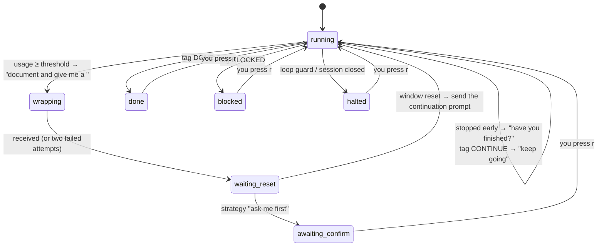

# How Relevo works

**English** · [Español](how-it-works.es.md)

This document explains what happens under the hood: how a conversation moves between VS Code, Claude Desktop and the CLI, why Relevo needs to "adopt" a conversation, how it decides what to do, and where every piece of information comes from.

## A conversation is a file, not a program

Each Claude Code conversation lives in a JSON Lines file:

```
~/.claude/projects/<project folder>/<session-id>.jsonl
```

It holds every message, every tool call and its result, the model used, the permission mode and so on.

The VS Code extension, Claude Desktop and the terminal are different interfaces to **the same `claude` agent program**. The VS Code extension ships its own copy of the binary. Whichever of them you use, a `claude` process:

1. loads the history file,
2. sends the conversation to Anthropic's servers, where the model runs,
3. runs the tools (editing files, running commands…) on your Mac,
4. appends every new step to the history file.

So the model runs in the cloud, but the agent (the loop that runs tools and keeps the history) runs on your machine, as long as some process has the conversation open.

## What happens when you close the conversation in VS Code

The extension ends its `claude` process and **the agent stops**. Nothing keeps running anywhere. Everything that had finished is already in the history file. If it was in the middle of a turn, that step is cut short, and any subagents it started stop with it.

## What Relevo does next

Relevo starts a new process with the CLI:

```sh
claude --resume <session-id> --remote-control --model <same model> --effort <same effort> --permission-mode <same mode>
```

inside a tmux session named `relevo-<first 8 characters of the id>`. That process reads the same history file and continues from the last saved point.

It is not the same process moving from one program to another. It is a **relay**: one process stops, another one picks up the history. This is why Relevo asks you to close the conversation first. If two processes had it open, both would write to the same history and it would split into two branches.

### Where it runs while Relevo has it

In that `claude` process inside tmux, on your Mac. tmux is a terminal that lives without a window, so the process keeps running even if you close Relevo or the terminal you started it from. Relevo sends messages by pasting text into that terminal and pressing Enter, exactly as you would.

### Where Remote Control fits

claude.ai and the Claude mobile app do not run anything. They are a **remote screen and keyboard** for whichever process has the conversation open. Relevo starts the CLI with `--remote-control`, and the link is tied to the conversation, so the same link connects to the new process. When no process has the conversation open, the web shows the history but nobody answers.

### Going back to VS Code

The same relay in reverse. Press `x` in Relevo (or `tmux kill-session -t relevo-<id>`) to end the process in tmux. Then open the conversation from the history in VS Code or Desktop, or with `claude --resume <id>`. The new process loads the full history, including everything that happened while Relevo had it.

<a id="why-adoption"></a>
## Why Relevo has to adopt the conversation

Relevo needs to type messages into the conversation as if they came from you. These options were tested and ruled out:

| Option | Why not |
|---|---|
| `claude -p --resume <id> "message"` | Works on a closed conversation, but if it is still open in VS Code, the new process writes a **parallel branch** into the history. The live session never sees the message. |
| The local cross-session messaging socket (`/tmp/cc-socks/<pid>.sock`) | An internal protocol. The receiving session treats those messages as coming from *another session*, not from the user, and may hold them back depending on its settings. |
| The Remote Control web API | Undocumented and requires your OAuth token to call it directly. |
| **Running the conversation in a terminal Relevo controls** | Uses only documented CLI flags. Messages arrive as real user turns, Remote Control keeps working, and permission prompts still reach you. ✔ |

## The decision loop

Every 10 seconds Relevo looks at the conversation, which costs nothing because it reads local files. Every 10 minutes (every 5 minutes from 70 %) it reads the account usage. With both readings it runs a pure state machine (`src/engine/machine.ts`), which returns a list of actions: send a message, notify, save a handoff, open a new conversation.



### Messages Relevo sends

All of them start with `[Relevo]` so they are easy to recognise in the conversation.

| When | Message (summary) |
|---|---|
| Usage reaches the threshold and subagents are running | Let the running agents finish, don't launch new ones, document the state and give me a prompt to continue later, between `<prompt></prompt>`. |
| Usage reaches the threshold, no subagents | Stop the task you are doing, document the state and give me a prompt to continue later, between `<prompt></prompt>`. |
| The reply has no `<prompt>` | Write the continuation prompt in full between the tags. (Only once. If it fails again, Relevo resumes later with a generic "pick up where you left off".) |
| The conversation stopped on its own | Have you finished? If something needs the user, write it in `RELEVO_PENDING.md` and continue with the rest. End with `<relevo>DONE</relevo>`, `<relevo>CONTINUE</relevo>` or `<relevo>BLOCKED</relevo>`. |
| After the reset | The window has reset; continue following this prompt: `…`. |

### When it decides the conversation has stopped

A conversation counts as stopped when all of these hold for 30 seconds (`settleSec`):

- the session registry says it is not busy,
- the last turn in the history has ended,
- no tool call is waiting for a result,
- no subagent is running.

If a tool call has had no result for more than a minute, or a dialog is on screen, Relevo treats it as waiting for you. It notifies you and does not push.

### Loop guard

Relevo stops and notifies you if:

- it has pushed `maxNudges` times (3) within `windowMin` minutes (15), or
- `maxNoProgress` turns in a row (2) answered a push without using a single tool.

## Where each piece of information comes from

| What | Source |
|---|---|
| Running sessions | `~/.claude/sessions/<pid>.json`: `sessionId`, `cwd`, `status` (`busy`/`idle`), `entrypoint` (`cli`, `claude-vscode`…), `bridgeSessionId` (Remote Control), `tmux` |
| Recent sessions | Modification time of the history files. Headless `claude -p` runs are skipped: their prompts have `turnOrigin: "sdk"` instead of `"human"`. |
| Model, effort, permission mode, title | The history file: `message.model` / `requestedModel` and `effort` on assistant records, the `permission-mode` record, the `ai-title` record |
| Turn finished | A `system` record with `subtype: "turn_duration"`, or an assistant message with `stop_reason: "end_turn"` and no pending tool calls |
| Subagents running | `<session-id>/subagents/agent-*.meta.json` without `finished: true`, whose log changed recently |
| Usage | `GET https://api.anthropic.com/api/oauth/usage` with the Claude Code OAuth token from the macOS Keychain. It returns `five_hour` and `seven_day` (plus per-model weekly windows), each with `utilization` and `resets_at`. If it fails, Relevo uses `cachedUsageUtilization` from `~/.claude.json`, which may be older. |
| Dialogs on screen | `tmux capture-pane` (folder trust, permission prompts) |

Relevo never stores or prints your token. It reads it from the Keychain on each usage check, and Claude Code itself keeps it fresh.

## What Relevo does not do

- It does not answer permission prompts for you.
- It does not change the model, the effort or the permission mode of the conversation.
- It does not call any AI model itself. The only tokens spent are the ones the conversation spends when it answers Relevo's messages.
- It does not touch the conversation's files. Claude may create `RELEVO_PENDING.md` in your project if it needs to note decisions for you.
